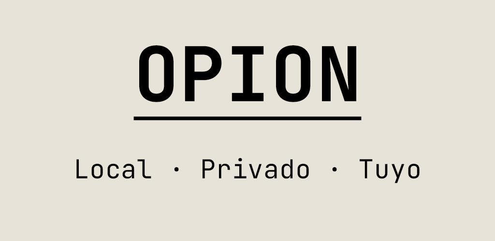
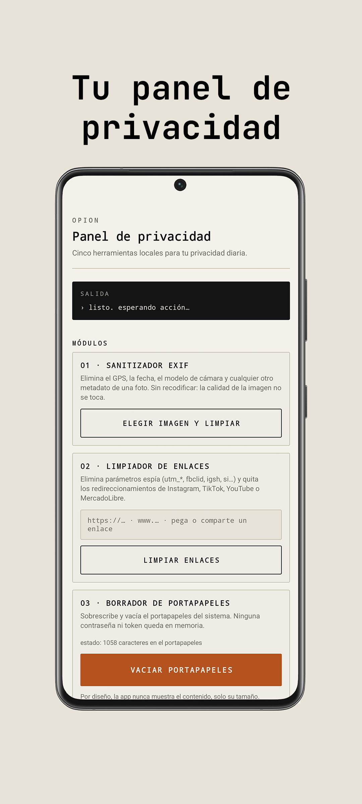
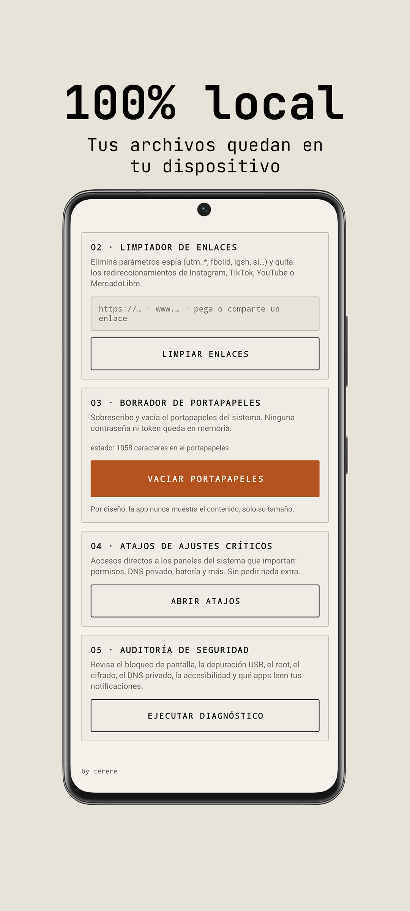
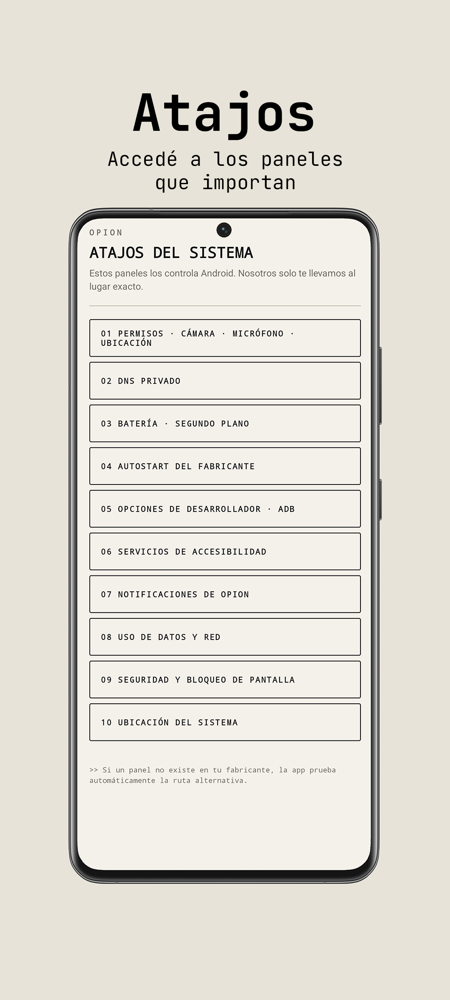
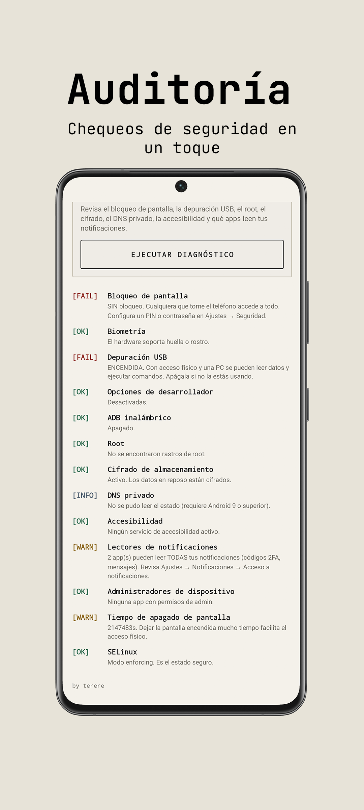

# Opion — Kit de Privacidad para Android

**Cinco herramientas de privacidad locales en una app liviana.**
Limpia los metadatos de tus fotos, quita el rastreo de los enlaces, borra el portapapeles, accedé directo a los paneles de privacidad del sistema y auditá tu dispositivo — todo en el dispositivo.

[English](README.md) · **Español** · [Português](README.pt.md)

> **Repositorio de exhibición.** Opion es un producto de código cerrado. El código fuente de la aplicación y el APK/AAB **no** se publican acá. Este repositorio documenta el producto, su diseño y su arquitectura.

---

## Por qué Opion

Cada foto que compartís lleva metadatos. Cada enlace que copiás arrastra parámetros de rastreo. Cada contraseña que pegás queda en el portapapeles. Opion te da cinco herramientas enfocadas y local-first para cerrar esas brechas — sin cuenta, sin nube y sin telemetría de tu contenido.

- **Local-first por diseño** — las fotos, los enlaces y el portapapeles nunca salen de tu dispositivo.
- **Liviana** — una sola app en lugar de cinco.
- **Trilingüe** — inglés, español y portugués.
- **Android 8.0+** (API 26).

## Funcionalidades

| Herramienta | Qué hace |
|---|---|
| **Sanitizador EXIF** | Elimina el GPS, la fecha, el modelo de cámara, los números de serie y cualquier otro metadato de una foto. Trabaja en sitio sobre el JPEG original — sin recodificar, sin pérdida de calidad. Los formatos no JPEG se recodifican para garantizar cero metadatos. |
| **Limpiador de enlaces** | Elimina parámetros de rastreo (`utm_*`, `fbclid`, `igsh`, `si`, `gclid`, `mc_eid` y más de 60) de cualquier URL, y quita los redireccionamientos de Instagram, TikTok, YouTube, Facebook y Google. Funciona con enlaces sueltos y con enlaces embebidos en texto. |
| **Borrador de portapapeles** | Un toque. El portapapeles se sobrescribe con ruido aleatorio y después se vacía, para que las contraseñas y tokens no queden en memoria. La app nunca muestra el contenido, solo su tamaño. |
| **Atajos del sistema** | Acceso directo a los paneles que importan: permisos, DNS privado, optimización de batería, autostart, accesibilidad, opciones de desarrollador y uso de datos. Con rutas alternativas automáticas para Xiaomi, Huawei, OPPO, vivo, Samsung y más. |
| **Auditoría de seguridad** | Un toque ejecuta 13 verificaciones contra APIs públicas — sin root. Informa el bloqueo de pantalla, la biometría, la depuración USB, las opciones de desarrollador, el ADB inalámbrico, los binarios de root, el cifrado del almacenamiento, el modo de DNS privado, los servicios de accesibilidad, los lectores de notificaciones, los administradores de dispositivo, el tiempo de apagado de pantalla y el estado de SELinux. |

## Capturas

<table>
  <tr>
    <td></td>
    <td></td>
    <td></td>
    <td></td>
  </tr>
</table>

## Diseño

Una estética minimalista **paper & ink**: tipografía monoespaciada, neutros de alto contraste y un diseño sin distracciones. Pensada para ser legible, rápida y liviana — sin adornos decorativos.

## Stack y arquitectura

| Capa | Tecnología |
|---|---|
| Lenguaje | Kotlin 2.2 |
| UI | Android Views + ViewBinding, ConstraintLayout, AppCompat (sin Compose) |
| SDK mínimo / objetivo | Android 8.0 (API 26) / API 36 |
| Concurrencia | Kotlin Coroutines |
| Metadatos de imagen | AndroidX ExifInterface |
| Monetización | Google AdMob + User Messaging Platform (consentimiento) |
| Build | Android Gradle Plugin 9.4, Java 17, R8 (minify + reducción de recursos) |

**Arquitectura en una frase:** un diseño feature-based y local-first — cada herramienta es un módulo aislado (`exif`, `links`, `clipboard`, `shortcuts`, `audit`) con su propia lógica de procesamiento, orquestado por las activities a través de ViewBinding, con la E/S fuera del hilo principal mediante corrutinas. No hay backend para el contenido del usuario.

## Privacidad y permisos

- Las fotos, los enlaces y el contenido del portapapeles se procesan **en el dispositivo** y nunca se envían a un servidor.
- Sin cuenta, sin registro, sin almacenamiento en la nube.
- La app usa el **selector de fotos del sistema** de Android (solo la imagen que elegís), lee el portapapeles solo para medirlo y sobrescribirlo, y usa internet para publicidad.
- Los anuncios los entrega **Google AdMob** (con consentimiento **UMP** donde corresponde) y pueden procesar el ID de publicidad y datos relacionados del dispositivo y del anuncio. Ver la política de privacidad.
- La auditoría de seguridad usa APIs públicas y **no requiere root**.

## Código cerrado

Este es un **repositorio de exhibición**. La aplicación Opion, su código fuente, sus assets de diseño y el contenido de este repositorio son **propietarios**. Todos los derechos reservados. Ver [LICENSE](LICENSE).

Podés referenciar el producto, enlazarlo y compartirlo. No podés copiar, modificar, redistribuir ni reutilizar el código o los assets sin permiso escrito.

## Enlaces

- **Google Play:** https://play.google.com/store/apps/details?id=com.opion.app
- **Política de privacidad:** https://yuri.net.ar/privacy/opion/es/ (también en [inglés](https://yuri.net.ar/privacy/opion/) y [portugués](https://yuri.net.ar/privacy/opion/pt/))
- **Soporte:** yuri@yuri.net.ar
- **Desarrollador:** Yuri Alexander Pagel Krüger — [yuri.net.ar](https://yuri.net.ar/)

---

Opion es una app independiente y no está afiliada, respaldada ni patrocinada por Google LLC. Google Play y el logo de Google Play son marcas de Google LLC.
