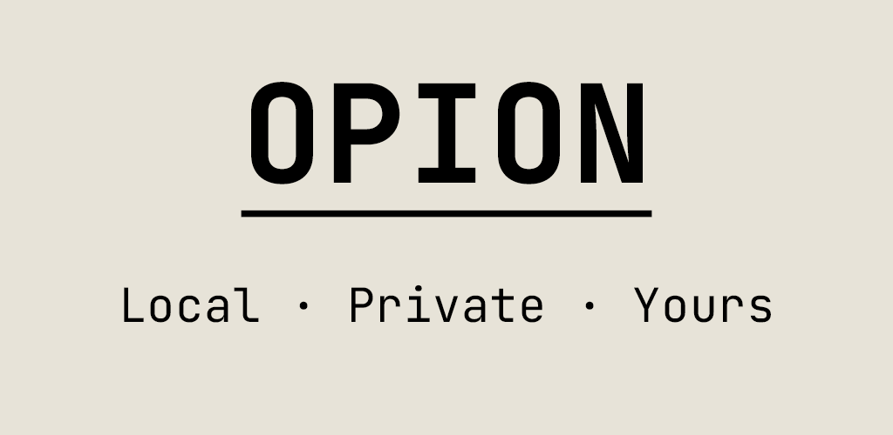
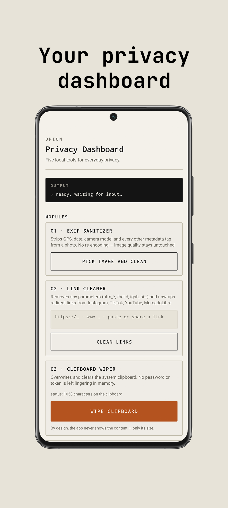
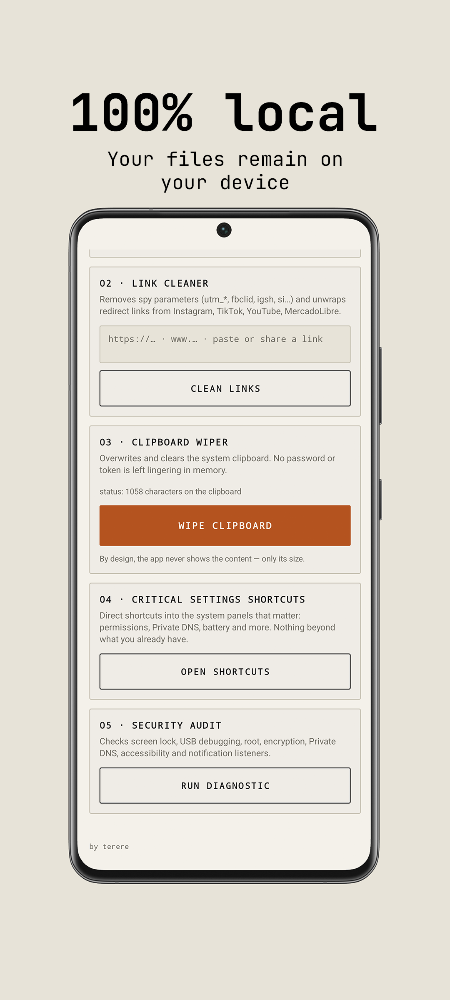
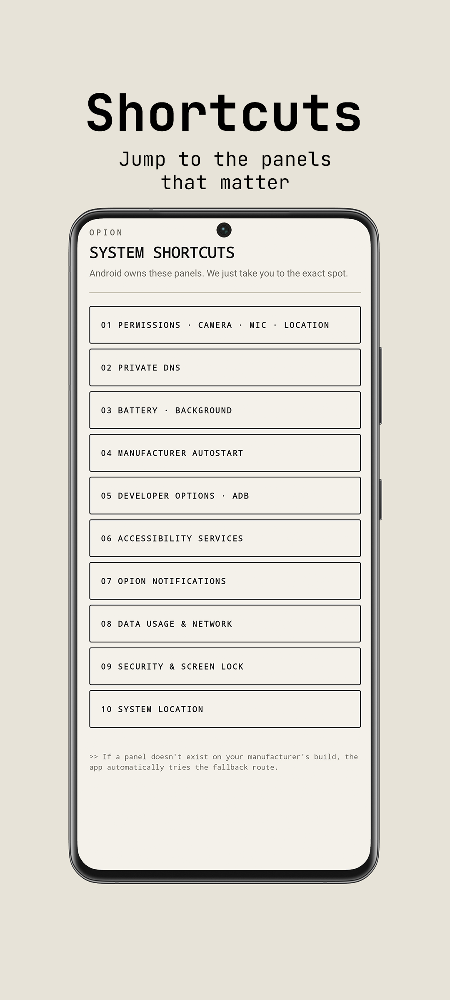
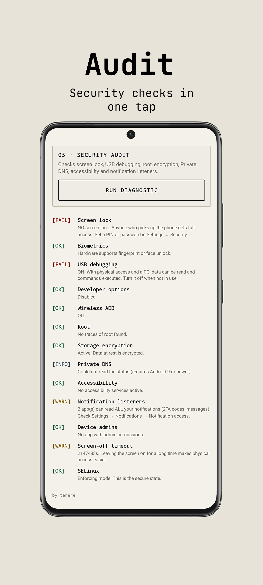

# Opion — Privacy Toolkit for Android

**Five local privacy tools in one lightweight app.**
Clean photo metadata, strip tracking from links, wipe the clipboard, jump straight to the system privacy panels and audit your device — all on-device.

**English** · [Español](README.es.md) · [Português](README.pt.md)

> **Showcase repository.** Opion is a closed-source product. The application source code and the APK/AAB are **not** published here. This repository documents the product, its design and its architecture.

---

## Why Opion

Every photo you share carries metadata. Every link you copy drags tracking parameters. Every password you paste lingers in the clipboard. Opion gives you five focused, local-first tools to close those gaps — no account, no cloud, and no telemetry of your content.

- **Local-first by design** — photos, links and clipboard content never leave your device.
- **Lightweight** — one small app instead of five.
- **Trilingual** — English, Spanish and Portuguese.
- **Android 8.0+** (API 26).

## Features

| Tool | What it does |
|---|---|
| **EXIF Sanitizer** | Strips GPS, timestamps, camera model, serial numbers and every other metadata tag from a photo. Works in-place on the original JPEG stream — no re-encoding, no quality loss. Non-JPEG formats fall back to a re-encode that guarantees zero metadata. |
| **Link Cleaner** | Removes tracking parameters (`utm_*`, `fbclid`, `igsh`, `si`, `gclid`, `mc_eid` and 60+ more) from any URL, and unwraps redirect links from Instagram, TikTok, YouTube, Facebook and Google. Handles bare URLs and URLs embedded in text. |
| **Clipboard Wiper** | One tap. The clipboard is overwritten with random noise and then cleared, so passwords and tokens stop lingering in memory. The app never shows the content — only its size. |
| **System Shortcuts** | Direct access to the panels that matter: permissions, Private DNS, battery optimization, autostart, accessibility, developer options and data usage. Automatic fallbacks for Xiaomi, Huawei, OPPO, vivo, Samsung and more. |
| **Security Audit** | One tap runs 13 checks against public APIs — no root required. Reports screen lock, biometrics, USB debugging, developer options, wireless ADB, root binaries, storage encryption, Private DNS mode, accessibility services, notification listeners, device admins, screen timeout and SELinux state. |

## Screenshots

<table>
  <tr>
    <td></td>
    <td></td>
    <td></td>
    <td></td>
  </tr>
</table>

## Design

A minimal **paper-and-ink** aesthetic: monospaced typography, high-contrast neutrals and a distraction-free layout. Built to be readable, fast and light — no decorative chrome.

## Stack & architecture

| Layer | Technology |
|---|---|
| Language | Kotlin 2.2 |
| UI | Android Views + ViewBinding, ConstraintLayout, AppCompat (no Compose) |
| Min / target SDK | Android 8.0 (API 26) / API 36 |
| Concurrency | Kotlin Coroutines |
| Image metadata | AndroidX ExifInterface |
| Monetization | Google AdMob + User Messaging Platform (consent) |
| Build | Android Gradle Plugin 9.4, Java 17, R8 (minify + resource shrinking) |

**Architecture in one line:** a feature-based, local-first design — each tool is an isolated module (`exif`, `links`, `clipboard`, `shortcuts`, `audit`) with its own processing logic, orchestrated by the app's activities through ViewBinding, with I/O off the main thread via coroutines. There is no backend for user content.

## Privacy & permissions

- Photos, links and clipboard content are processed **on-device** and are never sent to a server.
- No account, no sign-up, no cloud storage.
- The app uses the Android **system photo picker** (only the image you choose), reads the clipboard only to measure and overwrite it, and uses internet access for advertising.
- Ads are delivered by **Google AdMob** (with **UMP** consent where required) and may process the advertising ID and related device/ad data. See the privacy policy for details.
- Security Audit uses public APIs only and **does not require root**.

## Closed source

This is a **showcase repository**. The Opion application, its source code, its design assets and the contents of this repository are **proprietary**. All rights reserved. See [LICENSE](LICENSE).

You are welcome to reference the product, link to it and share it. You may not copy, modify, redistribute or reuse the code or assets without written permission.

## Links

- **Google Play:** https://play.google.com/store/apps/details?id=com.opion.app
- **Privacy policy:** https://yuri.net.ar/privacy/opion/ (also in [Spanish](https://yuri.net.ar/privacy/opion/es/) and [Portuguese](https://yuri.net.ar/privacy/opion/pt/))
- **Support:** yuri@yuri.net.ar
- **Developer:** Yuri Alexander Pagel Krüger — [yuri.net.ar](https://yuri.net.ar/)

---

Opion is an independent app and is not affiliated with, endorsed by or sponsored by Google LLC. Google Play and the Google Play logo are trademarks of Google LLC.
