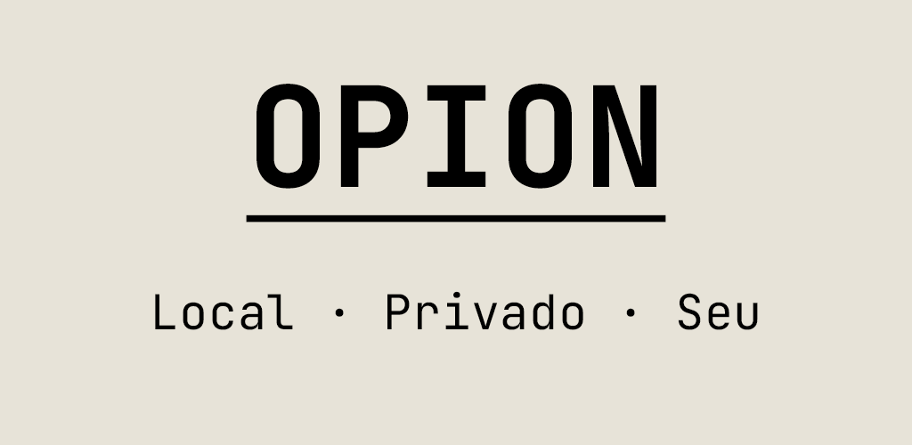
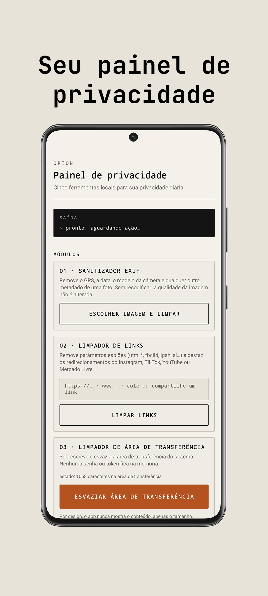
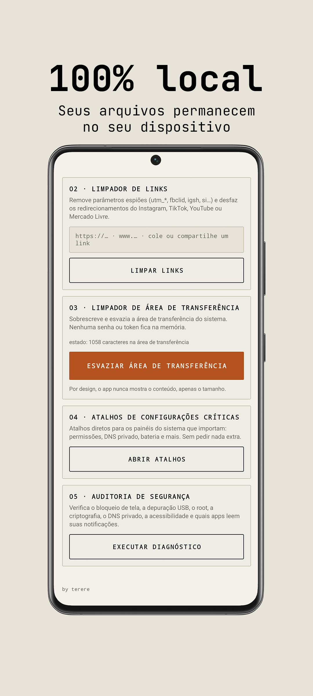
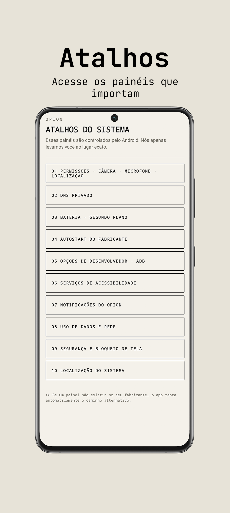
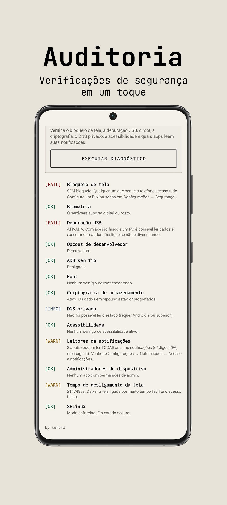

# Opion — Kit de Privacidade para Android

**Cinco ferramentas de privacidade locais em um app leve.**
Limpe os metadados das suas fotos, remova o rastreamento dos links, apague a área de transferência, acesse direto os painéis de privacidade do sistema e audite seu dispositivo — tudo no dispositivo.

[English](README.md) · [Español](README.es.md) · **Português**

> **Repositório de exibição.** Opion é um produto de código fechado. O código-fonte do aplicativo e o APK/AAB **não** são publicados aqui. Este repositório documenta o produto, seu design e sua arquitetura.

---

## Por que Opion

Toda foto que você compartilha carrega metadados. Todo link que você copia arrasta parâmetros de rastreamento. Toda senha que você cola fica na área de transferência. Opion oferece cinco ferramentas focadas e local-first para fechar essas brechas — sem conta, sem nuvem e sem telemetria do seu conteúdo.

- **Local-first por design** — fotos, links e área de transferência nunca saem do seu dispositivo.
- **Leve** — um único app em vez de cinco.
- **Trilíngue** — inglês, espanhol e português.
- **Android 8.0+** (API 26).

## Funcionalidades

| Ferramenta | O que faz |
|---|---|
| **Sanitizador EXIF** | Remove o GPS, a data, o modelo da câmera, os números de série e qualquer outro metadado de uma foto. Trabalha in-place no JPEG original — sem recodificar, sem perda de qualidade. Formatos não JPEG passam por uma recodificação que garante zero metadados. |
| **Limpador de links** | Remove parâmetros de rastreamento (`utm_*`, `fbclid`, `igsh`, `si`, `gclid`, `mc_eid` e mais de 60) de qualquer URL, e desfaz os redirecionamentos do Instagram, TikTok, YouTube, Facebook e Google. Funciona com links soltos e com links dentro de textos. |
| **Limpador de área de transferência** | Um toque. A área de transferência é sobrescrita com ruído aleatório e depois esvaziada, para que senhas e tokens não fiquem na memória. O app nunca mostra o conteúdo, apenas o tamanho. |
| **Atalhos do sistema** | Acesso direto aos painéis que importam: permissões, DNS privado, otimização de bateria, autostart, acessibilidade, opções de desenvolvedor e uso de dados. Com rotas alternativas automáticas para Xiaomi, Huawei, OPPO, vivo, Samsung e mais. |
| **Auditoria de segurança** | Um toque executa 13 verificações contra APIs públicas — sem root. Informa o bloqueio de tela, a biometria, a depuração USB, as opções de desenvolvedor, o ADB sem fio, os binários de root, a criptografia de armazenamento, o modo de DNS privado, os serviços de acessibilidade, os leitores de notificações, os administradores de dispositivo, o tempo de desligamento da tela e o estado do SELinux. |

## Capturas de tela

<table>
  <tr>
    <td></td>
    <td></td>
    <td></td>
    <td></td>
  </tr>
</table>

## Design

Uma estética minimalista **paper & ink**: tipografia monoespaçada, neutros de alto contraste e um layout sem distrações. Feito para ser legível, rápido e leve — sem adornos decorativos.

## Stack e arquitetura

| Camada | Tecnologia |
|---|---|
| Linguagem | Kotlin 2.2 |
| UI | Android Views + ViewBinding, ConstraintLayout, AppCompat (sem Compose) |
| SDK mínimo / alvo | Android 8.0 (API 26) / API 36 |
| Concorrência | Kotlin Coroutines |
| Metadados de imagem | AndroidX ExifInterface |
| Monetização | Google AdMob + User Messaging Platform (consentimento) |
| Build | Android Gradle Plugin 9.4, Java 17, R8 (minify + redução de recursos) |

**Arquitetura em uma frase:** um design feature-based e local-first — cada ferramenta é um módulo isolado (`exif`, `links`, `clipboard`, `shortcuts`, `audit`) com sua própria lógica de processamento, orquestrado pelas activities por meio de ViewBinding, com a E/S fora da thread principal via corrotinas. Não há backend para o conteúdo do usuário.

## Privacidade e permissões

- Fotos, links e conteúdo da área de transferência são processados **no dispositivo** e nunca são enviados a um servidor.
- Sem conta, sem cadastro, sem armazenamento na nuvem.
- O app usa o **seletor de fotos do sistema** do Android (apenas a imagem escolhida), lê a área de transferência apenas para medir e sobrescrever, e usa internet para publicidade.
- Os anúncios são entregues pelo **Google AdMob** (com consentimento **UMP** quando exigido) e podem processar o ID de publicidade e dados relacionados do dispositivo e do anúncio. Veja a política de privacidade.
- A auditoria de segurança usa APIs públicas e **não requer root**.

## Código fechado

Este é um **repositório de exibição**. O aplicativo Opion, seu código-fonte, seus assets de design e o conteúdo deste repositório são **proprietários**. Todos os direitos reservados. Veja [LICENSE](LICENSE).

Você pode referenciar o produto, linká-lo e compartilhá-lo. Não pode copiar, modificar, redistribuir ou reutilizar o código ou os assets sem permissão por escrito.

## Links

- **Google Play:** https://play.google.com/store/apps/details?id=com.opion.app
- **Política de privacidade:** https://yuri.net.ar/privacy/opion/pt/ (também em [inglês](https://yuri.net.ar/privacy/opion/) e [espanhol](https://yuri.net.ar/privacy/opion/es/))
- **Suporte:** yuri@yuri.net.ar
- **Desenvolvedor:** Yuri Alexander Pagel Krüger — [yuri.net.ar](https://yuri.net.ar/)

---

Opion é um app independente e não é afiliado, endossado ou patrocinado pela Google LLC. Google Play e o logo do Google Play são marcas da Google LLC.
